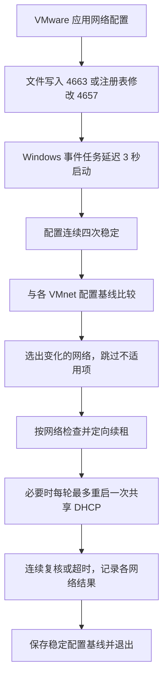

# 工作原理与边界

## 事件触发

只有一个 EventTrigger，没有产品常驻监控、开机/登录/定时触发、安装时运行、补跑或唤醒。Windows 自带事件日志和任务调度器承担触发工作。

文件订阅覆盖 `vmnetnat.conf`、`vmnetdhcp.conf` 的写入/追加/删除事件。配置目录项变更按安装时发现的 VMware 编辑程序路径过滤，用于捕捉原子替换；排除 DHCP 日常租约轮换。注册表订阅覆盖 VMnetConfig 下 vmnet0–19 及其 Adapter、DHCP、NAT 子键的 4657 值修改事件，补充只改变复选框的情况。注册表根设置可继承到子键的 SetValue 成功审计。读取、SACL 刷新都不匹配这些触发条件。

配置值由 VMware 注册表中实际的 UseAdapter、UseDHCP、UseNAT 标志识别；netmap.conf 的占位名称不作为网络存在的证据。不会因为新增同名 Windows 网卡就将它纳入修复。注册表路径优先读取 32 位 VMware 配置，兼容原生注册表视图路径。

依赖 Security 日志、文件系统/注册表成功审计、SACL 和 Task Scheduler。组策略可能覆盖审计开关，VMware 版本可能改变配置结构、保存进程或注册表键名大小写。VMware 安装/升级/恢复网络也可能写这些对象并触发检查。外部编辑器原子替换文件不属于保证范围。

## 按网络处理

安装/从 0.1 升级只读取配置、创建基线，不修复已有不一致。每次运行读注册表和文件，但只对指纹变化的 VMnet 查询实际 Windows 网卡。忽略单纯 NAT 端口转发变化。每个网络指纹由对应宿主机预留、子网配置、NAT host 节及注册表标志构成；不使用整份 DHCP 文件作为所有网络的指纹。

正常网络要求 DHCP 预留的 IP/MAC、唯一匹配子网、连续掩码、有效地址池和注册表一致；注册表显式保存的 IPSubnetMask 必须与 DHCP 掩码一致。NAT 网络另要求 NAT device、网关、前缀、可选 hostIp 与 DHCP 一致。仅主机网络不要求路由器声明或 NAT 服务。缺少权威地址/掩码时不猜测 .1 或 /24。

取消宿主机连接、DHCP 关闭、桥接及占位项报告跳过。Windows 静态地址、禁用网卡、缺失网卡、MAC 不符及默认路由均不强制修改。重叠子网和单网络配置错误会报告需要处理；其他有效变更可继续。

## 稳定性、重试和退出

- 配置需连续四次读取稳定，间隔一秒；修改前重新读取配置并检查网卡身份。
- 各网络独立计算成功次数和尝试次数；成功需三次连续观察。运行中新增、移除或再次修改网络会重新选择目标。
- 第一次定向 DHCP 续租；第二次可能重启共享 VMnetDHCP，仅释放目标网卡的旧 DHCP 租约后重新申请。每轮最多重启一次，且不会启动用户原本停止的服务或重启 NAT。
- 全局互斥锁防止并发工作。事件串行排队，后续无变化检查不查询实际网卡，也不覆盖最近有意义的结果。
- 每轮通常最多约 90 秒，单次续租最多 15 秒，任务两分钟硬上限；故障后退出，不留后台重试进程。
- 稳定且未被更新的配置会保存为新基线，包括失败或跳过的网络。以后修改别的网络不会再次尝试旧失败；失败原因保留在最近结果，需对目标网络重新应用变更或由管理员手动 Repair。

`-Mode Check` 只读检查所有已配置且适用的网络，不写数据。显式 `-Mode Repair` 可检查全部网络；自动任务使用 `-EventMode`。本工具不证明客体服务或全部 NAT 转发规则可用。

## 权限、迁移和数据

代码位于受保护的 `%ProgramFiles%\VmnetSync`，数据位于 `%ProgramData%\VmnetSync`，普通用户只读。任务以 SYSTEM 身份执行受保护代码。

安装清单版本 2 增加注册表审计目标，接受并迁移版本 1 的三项文件审计清单。0.3 将旧 Vmnet8Sync 目录与任务迁移至 VmnetSync，失败时恢复旧名与启用状态；两套目录并存时拒绝覆盖。配置指纹规范化换行/缩进，安装会重建旧格式基线，避免第一次编辑误选全部网络。升级先禁用任务并等待工作结束。失败时尝试恢复旧代码、清单、任务、基线、两类审计策略和本轮新增规则；成功重复安装保留有效基线，损坏基线可重建。安装期间配置变化会使安装回滚。

卸载只移除已知程序文件、任务和本工具新增的审计权限位。原有审计规则、全局审计策略与诊断数据保留。全局成功审计也可能让系统其他已设 SACL 的对象记录事件。

状态与基线原子替换写入，仅保留最近数据。`baseline.json`、`last-result.json`、`before-repair.json` 都不会被包含进发行包。

## 内存和验证范围

空闲时无产品进程，Windows 审计与调度基础设施有额外工作。执行期间使用 Windows PowerShell 和网络模块，不能承诺零内存；原生执行器可作为未来优化。

本机 Windows 11/Workstation 17.6.3 的真实 VMware Apply、VMnet1/VMnet8 跨子网旧租约修复、自定义 VMnet3 /23 修改、连接与 DHCP 开关、进程退出和安装生命周期均已验证。审计访问显式申请 ACCESS_SYSTEM_SECURITY，并通过 SetNamedSecurityInfo 将规则传递至已有子键。隔离集成测试另验证 4663/4657、继承规则清理和审计策略恢复。验收方法及边界见[验证记录](validation.md)。
