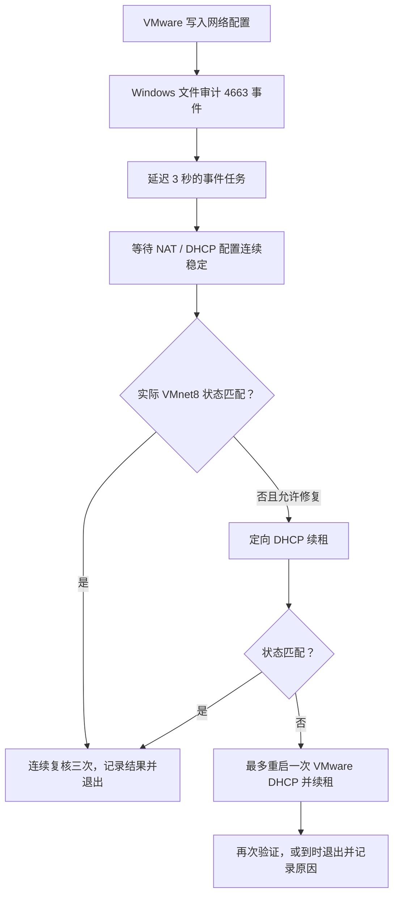

# 工作原理与边界

## 事件触发

没有自建的文件监控常驻程序，也没有周期性轮询任务。Windows 原有的事件日志和任务调度器提供唤醒能力。

事件订阅仅接受 `vmnetnat.conf`、`vmnetdhcp.conf` 的写入/追加/删除权限事件，另外接受 VMware 网络编辑程序对配置目录的目录项变更，用于覆盖原子替换。目录事件按已安装 VMware 的进程路径过滤，排除 DHCP 服务日常轮换租约文件；配置读取不会再次触发任务。

文件级写入也可来自直接编辑现有配置的程序；外部编辑器原子替换配置文件不属于当前保证范围。VMware 安装/修复、升级或重建网络也可能写入这些配置，从而触发检查；仅仅打开 VMware 不触发检查。

它依赖文件系统成功审计、文件 SACL、Security 日志和 Task Scheduler 正常工作。组策略可能覆盖审计开关，不同 VMware 版本也可能使用不同的文件保存进程。工作程序会在被替换的配置文件上补回审计规则。

## 稳定性与退出

- NAT 与 DHCP 配置必须相互一致，并连续四次读取稳定，间隔一秒。
- 修改前重新读取配置和网卡，取消过期操作。
- 成功要求三次连续验证；全局工作互斥锁防止同时操作。
- 多个触发串行排队，避免后续变更被上一轮忽略。文件写入密集时可能排队多轮短检查。
- 正常工作流程约 90 秒超时；任务设置两分钟硬上限。
- 没有开机/登录/定时触发，不补跑错过的任务，不唤醒电脑，不允许手动启动该任务。
- 状态原子写入 `last-result.json`，避免状态窗口读到半份 JSON。

## 修复限制

宿主机虚拟网卡需启用 DHCP。若地址、掩码或直连路由不匹配，先调用 `ipconfig /renew "实际网卡名称"`。第二次尝试最多重启一次共享 `VMnetDHCP` 服务，再定向续租。

缺少网卡、多个匹配网卡、MAC 与预留不符、网卡禁用、静态配置不匹配、意外默认路由及服务不运行时，会等待或记录 `NeedsAttention`，不覆盖用户设置。

成功判断来自文件配置与 Windows 实际网卡及路由。没有在本工具中使用 VMware 私有的 NAT 转发规则运行时接口，所以它不是全套 NAT 可用性证明。虚拟机内部地址、桥接/仅主机模式、自定义 VMnet、IPv6、Linux/macOS 宿主机均不在本版修复范围。

## 安装及权限

安装代码位于 `%ProgramFiles%\Vmnet8Sync`，状态位于 `%ProgramData%\Vmnet8Sync`。管理员与 SYSTEM 可写，普通用户只读。SYSTEM 任务不执行解压目录中的代码。旧版本升级先禁用触发、等待工作程序退出，再更新；安装发生异常时尝试恢复旧文件、任务、审计开关与本轮新增规则。

卸载只删除已知程序文件、自动任务及本工具增加的审计权限位，不递归删除未知内容。最近诊断数据保留，允许之后重新安装。全局文件审计策略不自动关闭，以免影响其他审计使用者。

## 内存

空闲时没有产品进程，但 Windows 的审计与任务基础设施并非没有开销。运行期间使用 Windows PowerShell 和系统网络管理模块，会有短暂进程工作集。若需要进一步减少执行期间的内存，后续可将执行器迁移到原生 Windows API；当前版本没有该实现。
